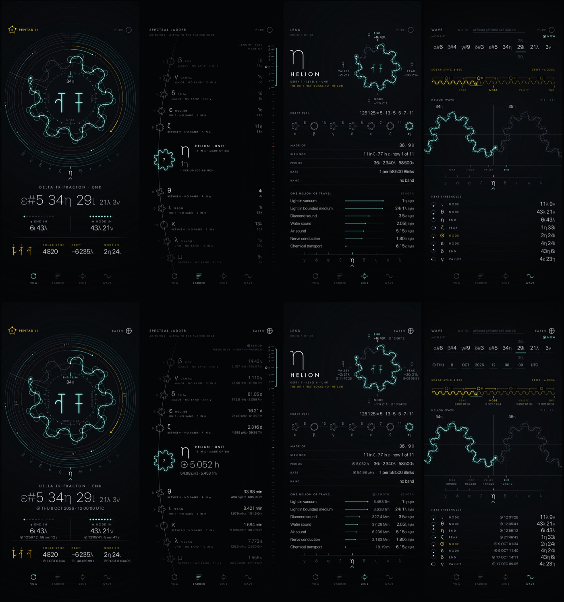

# Fractonica iOS

The Fractonica clock as a native SwiftUI app for iPhone, iPad and Mac.



*NOW, LADDER, LENS and WAVE at SPEC test vector A (2026-10-08T12:00:00Z), from the app's snapshot mode: pure mode above, Earth mode below.*

## What it is

Fractonica is an eclipse-anchored harmonic clock. Its anchor is the solar Saros series 141.
It counts time in nested cycles, from the Alpha (about 72 years) down through the Helion to the Blink,
and draws them as nested alternating arcs with phase glyphs.
This app shows that clock on Apple devices. It has four screens: NOW (the
instrument), LADDER (all 63 rungs of the spectral catalogue), LENS (one rung
in detail) and WAVE (a timeline you can drag to travel in time), and two
modes: pure shows only Fractonica units, and Earth adds the Gregorian and SI
translation beside them, marked ⊕. Every number and every word it shows comes
from the C core; the Swift code only draws.
The same clock runs in the browser at [fractonica.com](https://fractonica.com).

## The Fractonica repositories

| Repository | What it is |
|---|---|
| [core](https://github.com/fractonica/core) | The clock itself: a dependency-free C99 library, and the specification |
| **[ios](https://github.com/fractonica/ios)** (this one) | A SwiftUI app for iPhone, iPad and Mac, built on the core |
| [web](https://github.com/fractonica/web) | The core as WebAssembly and the clock as a static site, live at [fractonica.com](https://fractonica.com) |
| [esp32](https://github.com/fractonica/esp32) | ESP-IDF firmware for a small physical clock, with a host simulator; not yet run on hardware |

## Quick start

You need Xcode with a Swift 6 toolchain and
[XcodeGen](https://github.com/yonaskolb/XcodeGen). The app builds against
the core as a sibling checkout, so clone `core` next to `ios`:

```sh
brew install xcodegen
git clone https://github.com/fractonica/core.git
git clone https://github.com/fractonica/ios.git
cd ios

Tools/build.sh        # generate the Xcode project, build for the iPhone simulator and the Mac
Tools/test-kit.sh     # the Swift kit's tests (swift test)
Tools/test-app.sh     # the app's unit tests, on the Mac
Tools/test-ui.sh      # the UI tests, on the iPhone simulator
Tools/snapshot.sh     # render every screen to build/snapshots/*.png

open build/DerivedData/Build/Products/Debug/Fractonica.app   # run the Mac app
```

To work in Xcode, run `xcodegen generate` and open `Fractonica.xcodeproj`.
The project file is generated from `project.yml`; change that file, not the
project.

## What is in it

- One multiplatform SwiftUI app for iOS 17+ and macOS 14+. It depends only
  on Apple frameworks and the Fractonica C core.
- `FractonicaKit`, a Swift package that wraps the core in Swift value types.
  It has no clock arithmetic of its own.
- Two modes. Pure mode shows only Fractonica units: no dates, clock times,
  Hz or metres, not even in accessibility text. Earth mode adds the
  Gregorian and SI translation beside each reading, marked with ⊕.
- Global time travel: drag the wave, step a term of the stamp, or type a
  moment into GO TO. Every screen then shows that moment. Readings stay
  inside the catalogue (1613 to 2857) and are never extrapolated.
- Phone and desktop layouts. A wide Mac window or an iPad shows the desktop
  layout; a narrow window, Split View or an iPhone shows the phone layout.
- Tests: 92 kit tests that check the core's readings against the SPEC test
  vectors, 58 app unit tests, and UI tests that drive the running app on the
  iPhone and iPad simulators.
- A snapshot mode that renders every screen, mode and layout to PNG at a
  pinned instant (96 pictures). Most pictures in `docs/` come from it.

## Status

Version 0.1.0, built on core 0.2.0. Both builds and the kit and app
tests pass on the Mac, the UI tests pass on the iPhone 16 Pro and iPad (A16)
simulators, and the screens were checked by eye. It has been run by hand on a
physical iPhone, but no test has run on a device and no physical iPad has
been tried. On the Mac, keyboard, scroll and trackpad input, menu shortcuts
and the UI tests have not been exercised, and VoiceOver and Reduce Motion are
untested.

## Documentation

- [docs/GUIDE.md](docs/GUIDE.md): the full guide. The Swift API, every build
  script, how to use each screen, and the launch arguments.
- [AGENTS.md](AGENTS.md): the guide for coding agents and engineers working in
  this repository. The map of every file, the rules of the house, and what has
  and has not been verified.
- [SPEC.md](https://github.com/fractonica/core/blob/main/docs/SPEC.md): the
  clock's specification, in the core repository.

## Licence

No licence has been chosen yet. All rights reserved; see [LICENSE](LICENSE).
