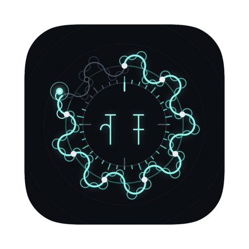
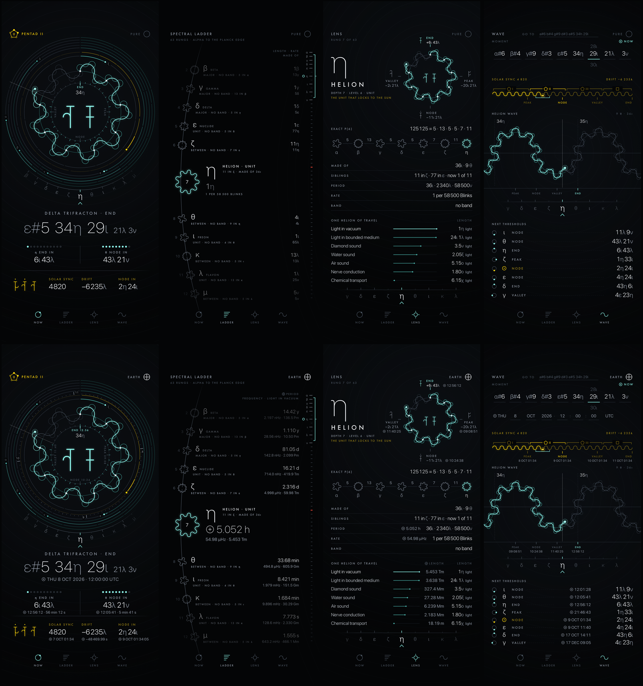
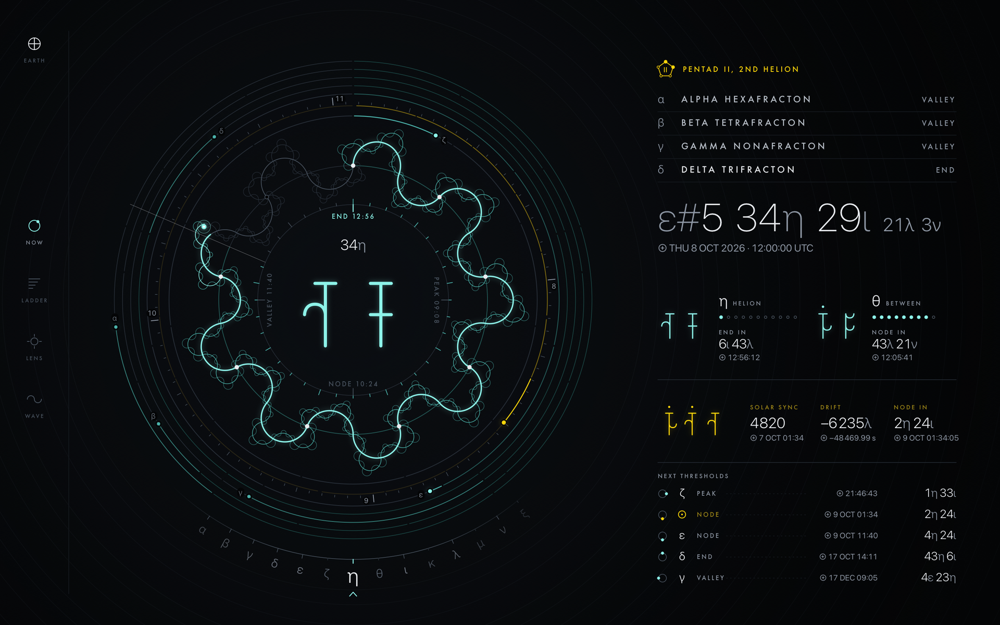
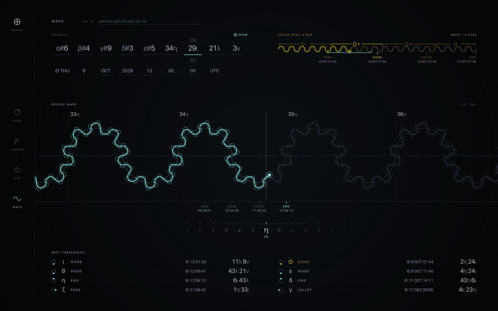
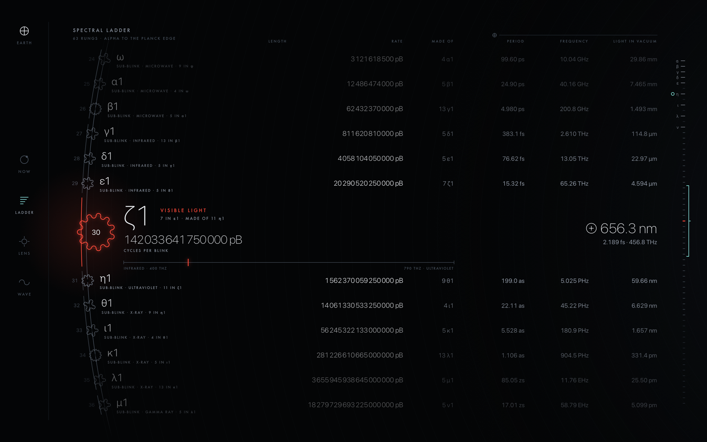
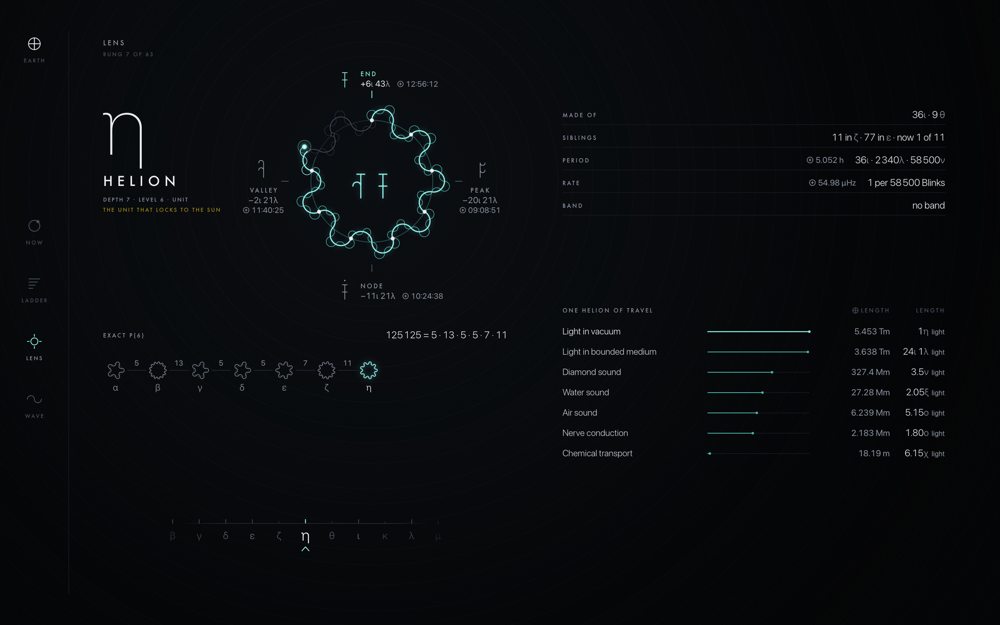

# Fractonica iOS guide



The native iPhone and Mac app for the **Fractonica clock**: an eclipse-anchored
harmonic clock. The app is an instrument, not a dashboard: nested alternating
circular arcs show every cycle, one cold light fills in what has already
happened, and in *pure* mode not a single Gregorian or SI unit appears.

- Targets: iOS 17+, macOS 14+. One multiplatform SwiftUI app.
- Dependencies: Apple frameworks and the Fractonica C core (`../core`). Nothing else.
- All clock arithmetic, names and text come from the core. The Swift code draws.

> **Status: 0.1.0, built, reviewed and verified** (stage 6 of 6; since adapted to the core's new functions, stage 7, and to core 0.2.0, stage 8).
> NOW (the instrument), LADDER (the spectral catalogue), LENS (one rung
> inspected) and WAVE (the timeline, with time travel) run on iPhone, iPad
> and Mac, in pure and Earth mode. What has and has not been verified, and
> where the app still differs from the design, is in `AGENTS.md` §8.



The pictures are the app's own snapshots at SPEC test vector A
(2026-10-08T12:00:00Z, `α#6 β#4 γ#9 δ#3 ε#5 34η 29ι 21λ 3ν`). More are in
[`docs/screens/`](screens):

| | |
|---|---|
|  |  |
|  |  |

## Repository layout

This repository is one of several siblings in the same organisation directory:

```
core/     the C99 library: the single source of all Fractonica arithmetic and text   (required)
design/   the shared visual language (astrolabe/DESIGN.md is the specification)       (to read)
SPEC.md   the clock specification                                                    (to read)
ios/      this repository
```

**The one build dependency is `../core`.** `FractonicaKit/Package.swift`
names it by path (`.package(path: "../../core")`, product `CFractonica`), so
the core must sit beside this repository:

```
git clone https://github.com/fractonica/core.git core
git clone https://github.com/fractonica/ios.git  ios
```

To pin the core to a commit instead, add it as a git submodule somewhere
inside this repository (say `Vendor/core`) and change that one path in
`FractonicaKit/Package.swift` to `../Vendor/core`. Nothing else names it.

```
ios/
  project.yml      the Xcode project, as XcodeGen reads it (the .xcodeproj is generated)
  FractonicaKit/   Swift package: a thin, documented Swift face of the C core
  App/             the app: Model, Design (tokens), Drawing, Instrument, Screens, Snapshot
  AppTests/        the app's unit tests
  AppUITests/      UI tests: the running app driven as a person would drive it
  Tools/           build, test, snapshot, screenshot and icon scripts
  docs/            this guide (GUIDE.md) and its pictures
  AGENTS.md        the map for engineers and coding agents: read it first
```


## FractonicaKit in one minute

```swift
import FractonicaKit

let clock = Catalogue.saros141                    // Solar Saros 141, built into the core
let now = Instant.now                             // Unix microseconds
// (the values in the comments are those of SPEC test vector A, Instant(unixSeconds: 1791460800))

let date = try clock.date(at: now)
date.text(.short, finest: .preon)                 // "Delta Trifracton End ε#5 34η 29ι"
date.stamp                                        // "α#6 β#4 γ#9 δ#3 ε#5 34η 29ι 21λ 3ν"

let helion = try clock.odometer(.helion, at: now) // the basic reading: two glyphs
helion.glyphs                                     // draw with glyph.outline(unit:origin:)
helion.nextChange                                 // redraw then; never poll

let next = try clock.nextThreshold(.helion, after: now)
try clock.span(from: now, to: next.instant!).text()   // "6ι 43λ"

let ring = Arc.fullCircle(center: center, radius: 102)             // the focused cycle
let arc = ring.child(m: 2 * Level.helion.factor, local: 0, odd: false)
arc.cgPath(from: 0, to: 0.4)                      // the lit part of one half-cycle
```

The kit has no arithmetic of its own: every value above is computed by the C
core. Outside the catalogue (1613 … 2857) readings throw
`FractonicaError.outOfRange`; the clock never extrapolates.

## Build, run and test

Requirements: Xcode with a Swift 6 toolchain and [XcodeGen](https://github.com/yonaskolb/XcodeGen)
(`brew install xcodegen`). Developed and tested with Xcode 27.1 (Swift 6.4)
and XcodeGen 2.45; nothing older has been tried.

```
Tools/build.sh             # generate the project, build for the iPhone simulator and for the Mac
Tools/test-kit.sh          # the kit's tests (swift test): 92
Tools/test-app.sh          # the app's unit tests, on the Mac: 58
Tools/test-ui.sh           # the UI tests, on the iPhone simulator (or: Tools/test-ui.sh "iPad (A16)")
Tools/snapshot.sh          # render every screen, mode and layout to build/snapshots/*.png (96 pictures)
Tools/simulator-shots.sh   # screenshot every screen in both modes on a simulator
Tools/icon.sh              # redraw the app icon with the instrument's own renderer
```

Each script exits with xcodebuild's own status, so
`Tools/build.sh && Tools/test-kit.sh && Tools/test-app.sh && Tools/test-ui.sh`
stops at the first failure.

Everything is built into `build/` (git-ignored), nothing outside this
directory except an empty, git-ignored `.swiftpm/` that Xcode leaves in
`../core` (`find ../core/.swiftpm -type d -empty -delete` removes it).

**Snapshots** are the real screens rendered to PNG without a window, at a
pinned instant (default: SPEC vector A, UTC):

```
Tools/snapshot.sh                                   # build/snapshots, vector A
Tools/snapshot.sh build/snapshots/B --t 946684800   # another instant, another directory
Tools/snapshot.sh build/snapshots/wide --size 2560x1080   # how the design fits another window
```

To work in Xcode: `xcodegen generate`, then open `Fractonica.xcodeproj` and
run the `Fractonica` scheme on "My Mac" or a simulator. The project file is
generated: change `project.yml`, never the project.

The Mac app, once built, is
`build/DerivedData/Build/Products/Debug/Fractonica.app`.

### Using the app

- **NOW** shows the instrument: the focused cycle as a ring of nested arcs,
  lit as far as it has run; its ancestors as rings around it, one planet
  each; the Sun's ring; the cycle's phase as two glyphs in the centre.
- **Turn the limb** (the scale of Greek letters under the instrument) to
  move between the scales: drag it, tap a letter, pinch the instrument or
  twist it (a deliberate turn: a pinch is never changed by a stray twist),
  scroll on a Mac, or press ← →. Tap a ring to focus it.
- **The ring at the top right** (top left on the Mac) switches between
  *pure* (only Fractonica) and *Earth* (Gregorian translations added, each
  led by ⊕). On the Mac: ⌘E. Screens: ⌘1 – ⌘4.
- Tap the centre of the instrument to open the lens on the focused level.
- **LADDER** is the spectral catalogue: all 63 rungs, from the Alpha to the
  Planck edge, on the rim of a great wheel. Drag to turn it (or drag the
  spine at the right edge, scroll, press ↑ ↓); tap the enlarged row to open
  the lens on it (Return); press and hold a row to focus the instrument on
  that rung (⌘↩ on a Mac), when it is one the instrument can show; a finer
  rung says "finer than the instrument reads".
- **LENS** inspects one rung: its lineage, what it is made of, its period
  and rate, the four thresholds of its running cycle, and how far light,
  sound and a nerve signal travel in one cycle. The limb at the bottom moves
  it across all 63 rungs. Swipe down, or press Escape, to go back.

- **WAVE** is the timeline: the cycles of the focused level laid along a
  line as a wave, lit up to a fixed hairline. **Drag the wave** to travel
  through time (it coasts, then settles on a threshold, or on the present,
  when one is within reach). Above it, the Sun's lane shows one solar sync
  with its Pentads: drag it for coarse moves, or tap it. At the top, the
  **stamp** is a row of nine tumblers: drag one up or down to step that term
  (on a Mac: scroll over it, or select it with ⌥← ⌥→ and press ↑ ↓). On a
  Mac a sideways two-finger swipe over the wave or the Sun's lane moves
  through time; scrolling up and down elsewhere changes the scale. In
  Earth mode the Earth date and time under it are tumblers too. **GO TO**
  takes a typed moment (it shows the moment in view as a ghosted example):
  a stamp (`α#6 β#4 γ#9 δ#3 ε#5 34η 29ι`), its ASCII
  shorthand (`a#6 b#4 g#9 d#3 e#5 34h 29i`), a short form (`34h 29i` keeps
  the coarser terms of the moment shown), a date in words; in Earth mode
  also `2026-10-08 12:00`. The limb under the wave changes the focused
  level and the wave re-scales to it.
- **Time travel is global.** Away from the present, every screen shows the
  scrubbed moment and a NOW mark with the offset as a span (`+3η 12ι`). Tap
  it (or ⌘0) to return. Time travel never leaves the catalogue.
- **Windows and devices.** A Mac window wider than tall shows the desktop
  arrangement; a narrow one (down to 360 pt, so it tiles into half of a
  laptop screen) the phone arrangement. An iPad shows the desktop
  arrangement, and Split View or Slide Over the phone one when narrow. On a
  small iPhone (SE) the design fills the screen and no engraved word falls
  under 6.2 pt. On the Mac the sigils and the mode ring have hover hints.

### Launch arguments

For tests and screenshots the app can be pinned from the command line:
`--t <unix seconds>` (freezes time), `--cursor <unix seconds>` (starts
scrubbed to that moment), `--mode pure|earth`,
`--screen now|ladder|lens|wave`, `--focus <level 0…13>`, `--rung <level 0…62>`,
`--theme astrolabe|basalt`, `--layout phone|desktop`, `--zone <identifier>`,
`--size <W>x<H>` (the Mac window, or the snapshots), `--snapshot <directory>`,
`--icon <directory>`. `AGENTS.md` §4 has the details.

The tests hold the kit against the vectors of SPEC.md (§12, §15.6, §16.5)
typed in literally, against the glyph table of §9.1 and against the arc
formulas of the design specification; the app's tests hold what the screens
draw against SPEC test vector A, and that nothing said in pure mode names an
Earth unit; the UI tests launch the app at vector A, turn the limb, toggle
the mode (by its word and by its ring), open each screen, scrub the wave and
return to NOW, and on an iPad turn it on its side.

## Rules of the house

- No Fractonica arithmetic, tables, naming or formatting in Swift. If the core
  lacks something, it is added to the core; the Earth-mode wordings are the
  core's too. What the core cannot provide yet (whether a sub-Blink period
  is legible, a rung's place in its band, the device wordings, the drift in
  seconds, and calendar walks for the Earth tumblers and the Sun's hour
  ticks) is in one marked file, `App/Model/ShimCoreGaps.swift`, with the
  core function that should replace each piece.
- Pure mode shows only Fractonica: no dates, clock times, zones, Hz, metres,
  SI prefixes or per cent, including in accessibility text and menus.
- Nothing blinks. No percentages anywhere.
- One token table for colours and type (`App/Design/Theme*.swift`); the
  Astrolabe theme is the default, Basalt a second value of the same table.

`AGENTS.md` has the full list and the map of every file.

## Licence

Apache License 2.0. See [LICENSE](../LICENSE).
